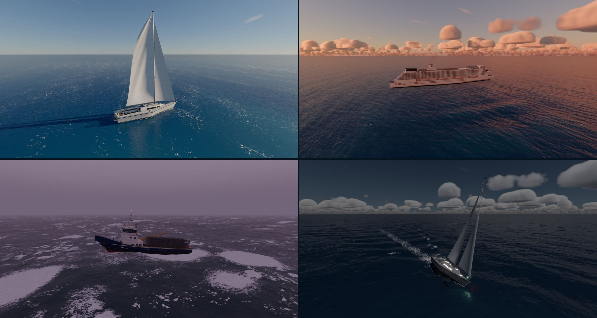

# Sea State

**Sail seven real-world boats through any weather, from glassy calm to a Category 5 hurricane, in your browser.**

Sea State is an ocean, weather and boat simulator built on [three.js](https://threejs.org) and WebGPU. Pick a boat, a region, the weather and a time of day, then take the helm. You can also put a whole fleet on the water and see how each boat handles the same sea.



**Play it:** <https://evanlask.github.io/sea-state/>

**Needs WebGPU:** a current Chrome or Edge, Safari 26+, or Firefox on Windows and Apple Silicon Macs. There is no WebGL fallback.

## The boats

| Boat               | Modelled on                        |
| ------------------ | ---------------------------------- |
| MV Meridian Trader | 3,600 TEU Panamax container ship   |
| MS Celestine       | Solstice-class cruise ship         |
| F/V Northern Reach | 125 ft Bering Sea crab boat        |
| Kittiwake          | C&C 115 sailboat                   |
| Tidewater 33       | 33 ft twin-outboard center console |
| Sea Dart RX        | 325 hp jet ski                     |
| U-7 Sea Fury       | H1 Unlimited hydroplane (200 mph)  |

## Features

- **Ocean:** an FFT ocean with whitecaps, foam, spray and boat wakes. The physics runs on the same waves you see.
- **Sky and weather:** a physically based sky with the real sun, moon and stars, volumetric clouds, rain, fog, lightning and the odd jet contrail. There are 15 weather presets, or set the wind and sea yourself.
- **Regions:** the Caribbean, North Atlantic, Bering Sea, Mediterranean, Southern Ocean and Arctic, each with its own sky, season, water colour, typical weather and swell.
- **Boat physics:** calibrated to real top speeds, turning circles and stopping distances. Boats ship water, flood and capsize.
- **Two physics modes:** **Arcade** (the default) answers the helm in seconds. **Realistic** keeps real masses and response times and adds an engineering telemetry panel.
- **Fleet mode:** several boats on the water at once, with autopilots and collisions.
- **Night:** COLREG navigation lights and signals, deck floods, lit cabins and searchlights.
- **Cameras:** helm, chase, orbit, hull, drone and cinematic, plus a photo mode with depth of field.
- **Storm Survival:** stay upright through a storm for as long as you can.
- **Sound:** synthesized engines, wind and thunder, with CC0 field recordings of the sea and rain.
- **Input:** keyboard and mouse.

## Controls

| Action                           | Key                      |
| -------------------------------- | ------------------------ |
| Throttle / telegraph / mainsheet | W / S                    |
| Steer                            | A / D                    |
| Center the rudder                | X                        |
| Thruster / trim / wing / jib     | Q / E                    |
| Brake, all stop, throttle off    | Space                    |
| Let fly (sailboat)               | Space                    |
| Camera                           | C / V, mouse, Z to reset |
| Photo mode                       | K                        |
| Lights: nav / deck / cabin       | 1 / 2 / 3 (or N / L)     |
| Lights: signals / extras         | 4 / 5                    |
| Switch boat                      | Tab                      |
| Horn                             | B                        |
| Recover a capsized boat          | Backspace                |
| HUD / help / pause               | H / F1 / Esc             |

In Arcade the steering centres itself when you let go; in Realistic the rudder stays where you leave it. The in-game Help screen lists every control for each boat.

## Run it locally

Requires Node 24.11 or newer.

```sh
npm install
npm run dev
```

| Script                  | What it does                         |
| ----------------------- | ------------------------------------ |
| `npm run dev`           | Dev server with hot reload           |
| `npm run build`         | Production build into `dist/`        |
| `npm run preview`       | Serve the production build           |
| `npm run check`         | Format, lint and type-check          |
| `npm run check:scripts` | Type-check the tooling in `scripts/` |
| `npm run test`          | Unit tests                           |

Pull requests run check, test and build in CI. Pushes to `main` deploy to GitHub Pages.

### Opening a scenario from the URL

Any scenario can be opened straight from the URL, which makes screenshots repeatable:

```
?boat=sail&weather=gale&time=18:30&region=bering-sea&cam=chase&physics=realistic&seed=1
```

Add `debug` for a tuning panel and console hooks. The address bar never changes during normal play.

## How it's built

- **Simulation** (`src/sim/`): the sea, weather, astronomy, boat hydrodynamics and sail model, run in a Web Worker at a fixed step. Plain TypeScript with no rendering dependencies.
- **Rendering** (`src/render/`): three.js WebGPU with TSL shaders: the FFT ocean, atmosphere, clouds, particles, post-processing and the procedural boat models.
- **App** (`src/app/`, `src/ui/`, `src/input/`, `src/camera/`, `src/audio/`): the menu and loading flow, HUD, controls, cameras and sound.
- **Assets** (`scripts/assets/`): `npm run assets` optimizes raw textures, models and audio into `public/` (KTX2, Meshopt, Opus/AAC) and writes the asset manifest.

[docs/DEVELOPMENT.md](docs/DEVELOPMENT.md) has the rest: every URL key, the asset pipeline, using your own boat model, and the code layout. [TODO.md](TODO.md) lists planned work.

## License

[MIT](LICENSE). Bundled third-party assets keep their own licenses: see [CREDITS.md](CREDITS.md).
